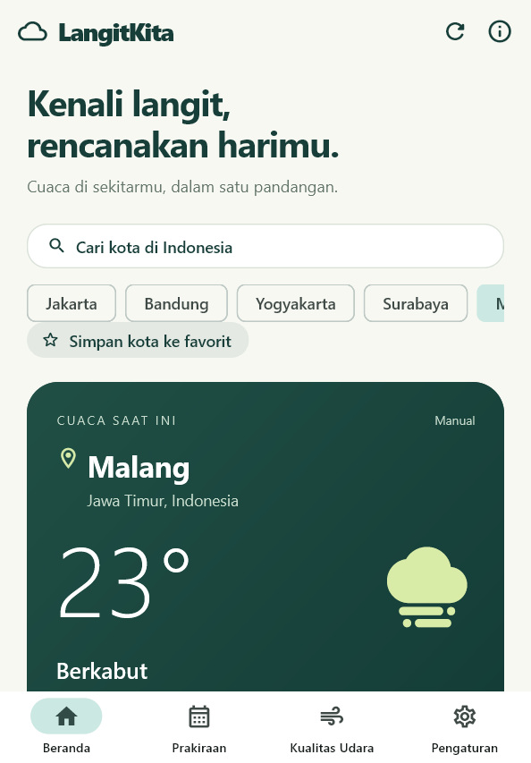
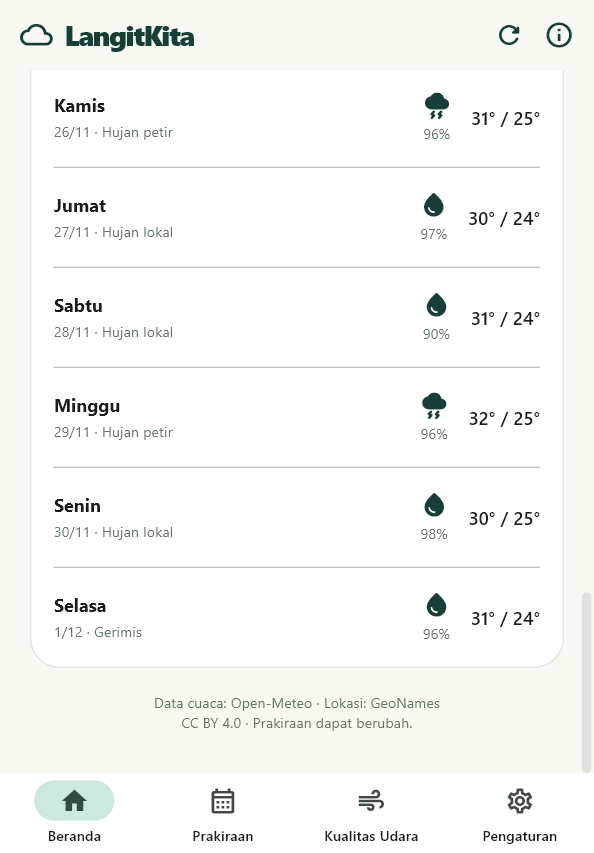
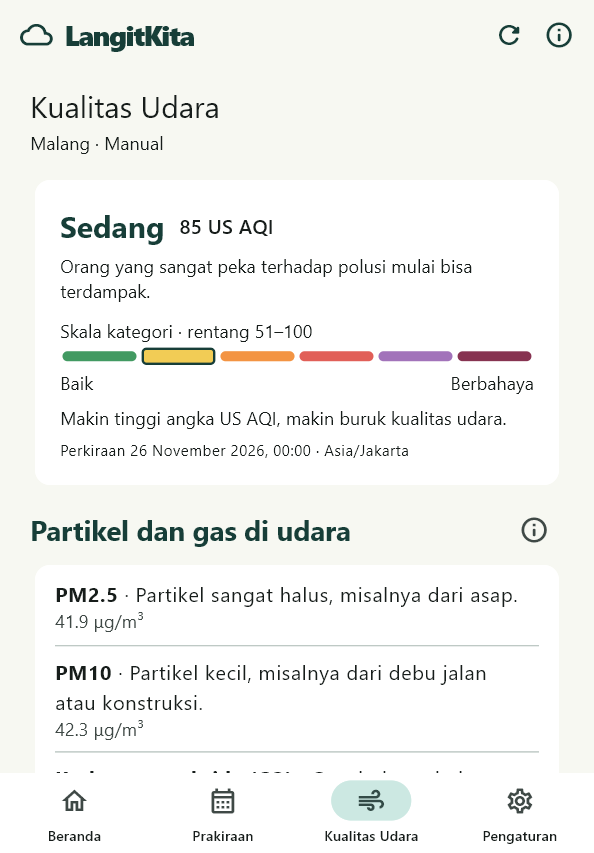

# UAS_Mobile_Praktikum

**LangitKita 2.0** adalah aplikasi Flutter untuk Ujian Akhir Semester (UAS) mata kuliah **Mobile Praktikum**. Aplikasi menampilkan cuaca, prakiraan, dan kualitas udara berdasarkan satu lokasi aktif, serta menawarkan pengingat hujan di Android.

## Identitas mahasiswa

| Keterangan | Isi |
| --- | --- |
| Nama | Arya Kharisudin Irfani |
| NIM | 240605110227 |
| Mata kuliah | Mobile Praktikum (Praktikum Pemrograman Mobile) |
| Tugas | Ujian Akhir Semester (UAS) |
| Program studi | Teknik Informatika |
| Kelas | G |

## Fitur

| Tab | Fungsi |
| --- | --- |
| **Beranda** | Melihat cuaca saat ini, suhu terasa, kelembapan, angin, dan peluang hujan. Pengguna bisa memilih kota cepat, mencari kota di Indonesia, menyimpan favorit, atau memakai lokasi perangkat. |
| **Prakiraan** | Membandingkan suhu dan peluang hujan pada grafik 24 jam. Pilih **7 Hari** untuk melihat ringkasan atau membuka detail UV, curah hujan, angin, matahari terbit, dan matahari terbenam. |
| **Kualitas Udara** | Membaca skor US AQI beserta arti kategori, rentang, waktu data, dan rincian enam polutan. Tombol info menjelaskan satuan konsentrasi. |
| **Pengaturan** | Memeriksa lokasi aktif dan status izin. Di Android, pengguna dapat mengatur ambang peluang hujan dan mengirim notifikasi uji. |

Aplikasi menyimpan kota manual terakhir, kota favorit, dan preferensi pengingat di perangkat. Cuaca dan kualitas udara memiliki status pemuatan dan pemulihan masing-masing, sehingga kegagalan salah satu layanan masih memungkinkan tab lain digunakan.

## Tampilan aplikasi

| Beranda | Prakiraan tujuh hari | Kualitas Udara |
| :---: | :---: | :---: |
|  |  |  |

Tangkapan diambil dari aplikasi Flutter yang berjalan di Windows. Data yang terlihat mengikuti waktu dan lokasi saat pengambilan gambar.

## Menjalankan proyek

**Prasyarat umum:** Flutter 3.47.2 dengan Dart 3.13.2 atau SDK yang kompatibel dengan `pubspec.yaml`, Git, dan koneksi internet untuk data Open-Meteo.

```powershell
git clone https://github.com/aryapulosari-design/UAS_Mobile_Praktikum.git
cd UAS_Mobile_Praktikum
flutter doctor
flutter pub get
```

### Windows

Instal Visual Studio dengan workload **Desktop development with C++**. Jalankan perintah berikut dari root proyek.

```powershell
flutter run -d windows
```

### Android

Siapkan Android SDK dan emulator atau perangkat dengan USB debugging. Jalankan `flutter devices`, kemudian gunakan ID perangkat yang ditampilkan.

```powershell
flutter run -d ID_PERANGKAT_ANDROID
flutter build apk --release
```

APK yang berhasil dibangun berada di `build/app/outputs/flutter-apk/app-release.apk`. Konfigurasi proyek menggunakan penandatanganan debug untuk build tugas.

## Sumber data dan izin

| Layanan | Data |
| --- | --- |
| [Open-Meteo Weather Forecast](https://open-meteo.com/en/docs) | Cuaca saat ini, seri per jam selama 24 jam, dan prakiraan tujuh hari dalam zona waktu lokasi. |
| [Open-Meteo Geocoding](https://open-meteo.com/en/docs/geocoding-api) | Nama dan koordinat kota untuk pencarian. Data lokasi berasal dari GeoNames. |
| [Open-Meteo Air Quality](https://open-meteo.com/en/docs/air-quality-api) | US AQI, PM2.5, PM10, CO, NO₂, SO₂, dan O₃. Angka berasal dari model CAMS ENSEMBLE. |

Instalasi aplikasi tidak memerlukan `.env` atau API key. Saat pengguna memilih **Gunakan Lokasi Saya**, aplikasi meminta izin lokasi melalui sistem dan mengirim koordinat aktif ke Open-Meteo untuk mengambil data. Pencarian kota tersedia sebagai pilihan manual.

Pengingat hujan Android memakai ambang awal **70%** dan menjadwalkan notifikasi 30 menit sebelum slot prakiraan pertama yang memenuhi ambang. Android dapat menunda pengiriman sesuai kondisi perangkat. Tombol **Tes notifikasi** memeriksa jalur notifikasi tanpa bergantung pada prakiraan.

## Teknologi dan struktur

- **Flutter, Dart, Material 3** untuk antarmuka, navigasi, dan tampilan data.
- **`http`** untuk mengambil cuaca, hasil pencarian, dan kualitas udara.
- **`shared_preferences`** untuk menyimpan favorit, lokasi manual terakhir, dan preferensi pengguna.
- **`geolocator` dan `geocoding`** untuk lokasi perangkat di Android dan Windows serta nama wilayah di Android.
- **`flutter_local_notifications` dan `timezone`** untuk pengingat hujan lokal di Android.

```text
lib/
  main.dart dan app.dart    Entry point dan tema aplikasi
  models/                  Lokasi, cuaca, dan kualitas udara
  services/                API, lokasi perangkat, penyimpanan, dan notifikasi
  screens/ dan widgets/    Tab, pencarian kota, detail prakiraan, dan UI
  utils/                   Format tanggal, waktu, dan kondisi cuaca
test/                      Pengujian Dart dan widget Flutter
docs/                      Catatan UAS, arsip UTS, dan screenshot
```

## Pengujian

```powershell
flutter analyze
flutter test --reporter expanded
```

Verifikasi versi 2.0 di Windows menghasilkan analisis bersih dan **43 tes lulus**. Tes mencakup pergantian lokasi, penanganan data kosong dan gagal, favorit, rentang AQI, tata letak layar kecil, dan penjadwalan pengingat dengan plugin tiruan. Beranda, prakiraan, dan kualitas udara juga diperiksa di aplikasi Windows dengan data Open-Meteo. Pengambilan lokasi perangkat dan pengiriman notifikasi Android masih perlu diuji langsung.

## Dokumentasi

- [Catatan implementasi dan hasil pengujian UAS](docs/KESESUAIAN_UAS.md)
- [Pemeriksaan versi UTS](docs/KESESUAIAN_UTS.md) dan [arsip laporan UTS](docs/laporan.html)
- [Repositori awal UTS](https://github.com/aryapulosari-design/UTS-Mobile-Praktikum)
